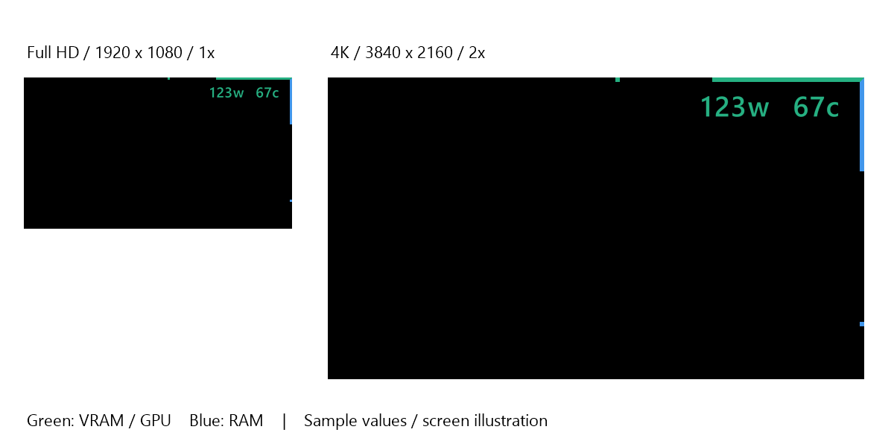

# SYSTEM Monitor Overlay

**[日本語](README.md) | English**

A lightweight, portable Windows GPU and memory monitor. Corner overlays show VRAM and system RAM usage as bars, with optional text for GPU board power and temperature. Written in C# with WinForms; AMD Radeon and NVIDIA GeForce telemetry is supported where the driver provides it.

**[Download the latest release](https://github.com/Hidenori-Kideaji/SYSTEM-Monitor-Overlay/releases/latest)**

The settings window currently uses Japanese labels. This guide includes an English reference for those controls; it does not change the application's interface language.

## Getting started

1. Download `SYSTEM-Monitor-Overlay-v1.0.0-win-x64.zip` from Releases and extract it to a folder you can write to. Do not run it from inside the ZIP.
2. Run `SYSTEM Monitor Overlay.exe`. **The app starts in the system tray; the settings window does not open automatically.**
3. Double-click its tray icon to open settings. If the icon is not visible, check the tray's hidden icons.
4. The window's **×** button hides settings without stopping monitoring. To quit completely, right-click the tray icon and select **終了 (Exit)**.

The executable can run on its own when the required runtime is present. Settings are saved to `Config.ini` beside the executable. Keep this file when updating or moving the app if you want to preserve your settings.

Start with Windows is optional and is enabled only when you turn on its toggle. If you move the executable after enabling startup, turn the toggle OFF and then ON to register the new path.

## Previews




The black rectangles represent screens; the white area is the surrounding illustration background. The horizontal green bar shows VRAM usage and the vertical blue bar shows RAM usage. The actual overlay has a transparent background: only the bars and readings appear over your desktop.

These images use test values and settings. They do not represent initial defaults or live measurements.

## Settings reference

| Japanese label | English meaning / function |
| --- | --- |
| ライト ↔ ダーク | Switch the settings window between light and dark themes. |
| スタートアップに登録 | Start the app automatically when you sign in to Windows. |
| オーバーレイ表示 | Show or hide the corner overlay. |
| 更新間隔 | Refresh interval: 1–5 seconds, in 1-second steps. |
| 不透明度 | Overlay opacity: 10–100%. Lower values are more transparent. |
| 左 ↔ 右 | Place the mirrored overlay in the upper-left or upper-right corner. |
| GPU電力 | Show GPU board power in the overlay. |
| GPU温度 | Show GPU temperature in the overlay. |
| 文字サイズ | Overlay text size. |
| 回転 | Text rotation: 0°, 90°, or 270°. |
| 文字 X / 文字 Y | Horizontal / vertical text offset from the selected screen corner. |
| 文字間隔 | Spacing and layout of the power/temperature text; see below. |
| GPU / RAM color swatches | Click a swatch to choose a color. GPU and VRAM share one color; RAM uses the other. |
| バー太さ | Bar thickness. |
| バー長さ | Bar length. |

Text spacing of **0 or greater** places power and temperature side by side. **-1** stacks them on two lines; **-2 and lower** increase the vertical gap. Overlay units are compact ASCII characters, for example `123w` and `67c` (watts and degrees Celsius).

## Features

- The settings window shows GPU utilization, board power, temperature, and VRAM/RAM usage in GiB and percent. `BRD` means board power; `TMP` means temperature.
- The horizontal bar represents VRAM usage and the vertical bar represents system RAM usage. A 45° join avoids overlap at the corner.
- Adjustable corner position, bar dimensions, colors, text size, rotation, offsets, spacing, opacity, and refresh interval.
- GPU power and temperature text can be enabled independently.
- Fixed digit advances, value fields, and unit positions reduce movement as readings change.
- Automatic overlay scaling: 1× at Full HD, approximately 1.33× at WQHD, and 2× at 4K. Pixel settings use Full HD as their reference.
- Click-through overlay. When a foreground full-screen window is detected, the overlay moves behind it.
- System-tray startup, single-instance protection, and optional start-with-Windows registration.

## Requirements and limitations

- Intended for **Windows 10/11 x64 with .NET Framework 4.8** and the GPU vendor's official driver.
- AMD telemetry uses ADL/PMLog; NVIDIA telemetry uses NVML. Unsupported or unavailable readings display `--`. Sensor availability depends on the GPU and driver.
- Developed and tested on a Radeon RX 9070 XT. Power and temperature readings on a GeForce RTX 5070 Ti have also been confirmed by a user. This is not a guarantee of compatibility with every GPU.
- On multi-GPU systems, the app selects the adapter with the highest dedicated VRAM usage. This does not necessarily identify the GPU rendering the active application.
- The overlay appears on the **primary display**. Its scale is the shorter screen-resolution dimension divided by 1080, clamped to 1–4×. It is not based on the monitor's physical size in inches.
- Full-screen handling relies on detecting ordinary desktop windows. Exclusive full-screen games and other special display modes may behave differently.
- The distributed executable is **not code-signed**. Windows may show a warning. Verify the download source and SHA-256 checksums; you do not need to disable security features.

## Reliability and local data

GPU data collection runs in two reusable child processes. Timeouts and worker restarts allow recovery when a query stalls. Seeing a total of **three processes with the same application name** in Task Manager is normal. A Windows Job Object terminates the child processes when the parent exits.

Settings are stored locally in `Config.ini`, with the previous version retained as `Config.ini.bak`. A diagnostic file named `GPU-diagnostics.txt` may also be created beside the executable. The app has no network-upload or automatic-update feature. Review diagnostic files before sharing them.

## Build from source

Run the following in Windows PowerShell from the repository root. No additional Visual Studio installation or NuGet packages are required when the existing .NET Framework compiler is available.

```powershell
powershell -NoProfile -ExecutionPolicy Bypass -File .\src\Build.ps1
```

The output is `outputs\SYSTEM Monitor Overlay.exe`. The script uses the existing .NET Framework compiler; if it is missing, the script stops instead of installing anything automatically. `ExecutionPolicy Bypass` applies only to this PowerShell process and does not change the system-wide policy.

## Tests

```powershell
powershell -NoProfile -ExecutionPolicy Bypass -File .\src\Test.ps1
# Optional short resource-usage benchmark
powershell -NoProfile -ExecutionPolicy Bypass -File .\src\Test.ps1 -Benchmark
```

Tests write to `tests\run-*` and cover tray behavior, worker timeouts, rendering, and GPU queries. They require a desktop session and access to a real GPU, and are not designed for generic GPU-less CI runners. Test windows and overlays appear briefly during the run. The initial public release passed 255 regression tests; hardware-dependent readings may still be unavailable on an individual PC.

## Reporting issues

Open an [issue](https://github.com/Hidenori-Kideaji/SYSTEM-Monitor-Overlay/issues) with your Windows version, GPU model, driver version, symptoms, and steps to reproduce the problem. Remove personal information from diagnostic logs and screenshots before posting them.

## License

[MIT License](LICENSE) — Copyright (c) 2026 Hidenori-Kideaji.

Segoe UI, Windows components, and GPU-driver libraries are used from the installed OS/driver and are not bundled in this repository. Product names and trademarks belong to their respective owners.
