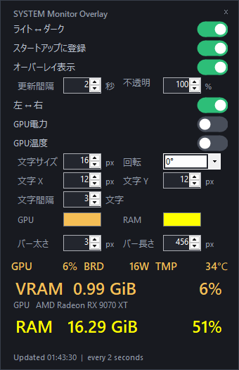
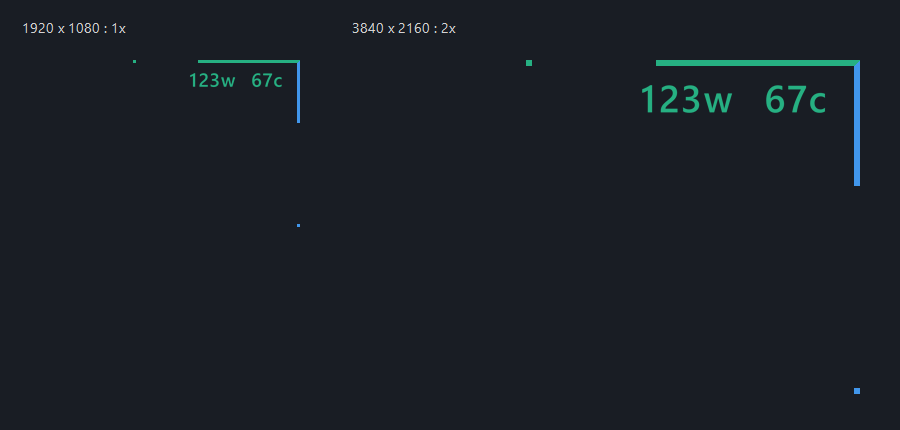

# SYSTEM Monitor Overlay

**日本語 | [English](README.en.md)**

Windows向けの軽量なGPU・メモリ監視アプリです。画面の角にVRAMとRAMの使用率をバーで表示し、GPU電力・温度を文字で重ねて表示できます。

A portable Windows system monitor with corner overlays for VRAM/RAM usage and optional GPU power/temperature text. Written in C# with WinForms; supports AMD Radeon and NVIDIA GeForce telemetry where the driver provides it.

**[ダウンロード / Download](https://github.com/Hidenori-Kideaji/SYSTEM-Monitor-Overlay/releases/latest)**

## 使い方

1. Releasesから `SYSTEM-Monitor-Overlay-v1.0.0-win-x64.zip` をダウンロードし、書き込み可能なフォルダへ展開します。
2. `SYSTEM Monitor Overlay.exe` を起動します。**最初から通知領域（システムトレイ）に常駐するため、設定ウインドウは自動では開きません。**
3. 通知領域のアイコンをダブルクリックすると設定ウインドウが開きます。アイコンが見えない場合は通知領域の隠れたアイコンを確認してください。
4. ×ボタンは設定ウインドウを隠します。完全に終了するには、通知領域アイコンを右クリックして「終了」を選びます。

exe単体でも起動できます。設定を変更するとexeと同じフォルダに `Config.ini` を保存します。別PCへの移動や更新時に設定を引き継ぐ場合は、このファイルも残してください。

スタートアップ登録はユーザーがトグルをONにしたときに行います。exeを移動した場合は、OFF→ONで移動後のパスを登録してください。

## 表示例





画像はテスト用の値・設定による描画例です。初期設定や実際の測定値とは異なります。

## 主な機能

- 設定ウインドウにGPU使用率、ボード電力、温度、VRAM・RAM使用量と割合を表示。
- 横のバーはVRAM使用率、縦のバーはRAM使用率。画面角の接合部を45°で分割。
- 左上・右上の切り替え、バーの太さ・長さ、GPU色・RAM色を設定可能。
- GPU電力・温度のオーバーレイは個別にON/OFF可能。
- 文字サイズ、0°/90°/270°の回転、画面角からのX/Y距離、文字間隔を設定可能。
- 数字の送り幅・表示枠・単位の位置を固定し、値の変化による位置ずれを抑制。
- 文字間隔は0以上で横並び、-1で縦2段、-2以下で縦方向の間隔を拡大。
- フルHDは1倍、WQHDは約1.33倍、4Kは2倍で自動描画。設定値はフルHD基準のpx値。
- 更新間隔1～5秒、不透明度10～100%、ライト/ダークの設定ウインドウ。
- オーバーレイはクリック透過。前面のフルスクリーンウインドウを検出すると背面へ移動。
- 常駐起動、二重起動防止、任意のスタートアップ登録。

## 動作環境・制限

- Windows 10/11 x64、.NET Framework 4.8を想定。GPUドライバーは各ベンダーの正規ドライバーが必要です。
- AMDはADL/PMLog、NVIDIAはNVMLを利用。取得できない項目は `--` と表示します。センサーの対応はGPU・ドライバーによって異なります。
- Radeon RX 9070 XTで開発・実機検証し、GeForce RTX 5070 Tiではユーザーによる電力・温度取得の確認を行っています。すべてのGPUでの動作を保証するものではありません。
- 複数GPU環境では専用VRAM使用量が最も多いアダプターを選択します。描画に使われているGPUを必ず特定するものではありません。
- オーバーレイの表示先はメインディスプレイです。倍率は解像度の短辺÷1080（1～4倍）であり、モニターのインチ数に基づくものではありません。
- フルスクリーンの扱いは通常のデスクトップウインドウの検出によるもので、ゲームの排他モード等では動作が異なる場合があります。
- 配布exeはコード署名されていません。環境によってWindowsの警告が出る場合があります。入手元とSHA-256を確認してください。セキュリティ機能を無効にする必要はありません。

## 安全設計とデータ

GPU取得は再利用する2つの子プロセスに分離し、取得が止まった場合はタイムアウトと再起動で回復します。タスクマネージャーに同名プロセスが合計3つ見えるのは通常の構成です。親プロセス終了時はWindows Job Objectで子プロセスも終了します。

設定はローカルの `Config.ini` に保存し、前回分を `Config.ini.bak` に残します。診断用の `GPU-diagnostics.txt` がexeと同じフォルダに生成される場合があります。アプリにネットワーク送信・自動アップデート機能はありません。診断ファイルを共有する際は内容を確認してください。

## ソースからビルド

WindowsのPowerShellでリポジトリのルートから実行します。Visual StudioやNuGetパッケージの追加は不要です。

```powershell
powershell -NoProfile -ExecutionPolicy Bypass -File .\src\Build.ps1
```

`outputs\SYSTEM Monitor Overlay.exe` が生成されます。スクリプトは既存の.NET Frameworkコンパイラーを利用します。見つからない場合は停止し、自動インストールはしません。`ExecutionPolicy Bypass` はこのPowerShellプロセスだけに指定し、システム設定は変更しません。

## テスト

```powershell
powershell -NoProfile -ExecutionPolicy Bypass -File .\src\Test.ps1
# 追加の短時間リソース計測
powershell -NoProfile -ExecutionPolicy Bypass -File .\src\Test.ps1 -Benchmark
```

テストは `tests\run-*` に出力し、トレイ動作・子プロセスのタイムアウト・描画・GPU取得を検証します。実GPUへのアクセスとデスクトップセッションが必要で、一般的なGPUのないCIランナー用ではありません。テスト中はテスト用ウインドウやオーバーレイが一時表示されます。

## 不具合報告

[Issues](https://github.com/Hidenori-Kideaji/SYSTEM-Monitor-Overlay/issues)に、Windowsのバージョン、GPU名、ドライバーバージョン、症状と再現手順を記載してください。診断ログやスクリーンショットに個人情報を含めないでください。

## ライセンス

[MIT License](LICENSE) — Copyright (c) 2026 Hidenori-Kideaji.

Segoe UI、Windows、およびGPUドライバーのライブラリはOS/ドライバーから利用し、このリポジトリには同梱していません。各製品名・商標はそれぞれの権利者に帰属します。
